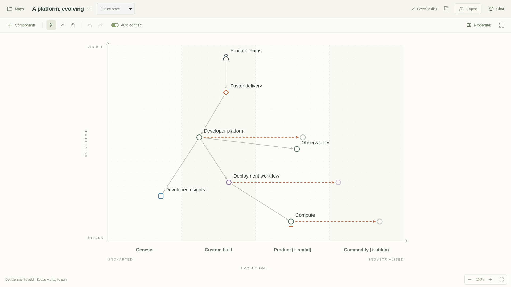

# Wardley Studio

An open-source desktop app for drawing Wardley maps, exploring dependencies, and discussing how a system could evolve. Built with Tauri, Rust, TypeScript, and SVG, with local JSON files, optional remote storage, and an optional AI mapping assistant.

[](https://github.com/mmacphail/wardley-studio/actions/workflows/ci.yml)
[MIT license](LICENSE) · [Feature tour](docs/FEATURE_TOUR.md) · [Get started](#get-started) · [User guide](docs/USER_GUIDE.md) · [API](API.md)



_The native Linux app displaying the included “A platform, evolving” example._

## What is it for?

A Wardley map starts with a user and a need, then shows the capabilities needed to meet that need. The vertical axis represents visibility to the user; the horizontal axis represents evolution, from something new and uncertain to something widely understood and standardised.

Wardley Studio gives you a visual workspace for that conversation. Sketch a service, trace its dependencies, compare a future state, or explore where to build, buy, and improve. Move components as your understanding changes, keep notes with the map, and export the result for discussion.

You can start with the included coffee shop, developer platform, and working practices examples. Local mapping works offline and requires no account or server.

## Features at a glance

| Capability                     | What you can do                                                                                                                     |
| ------------------------------ | ----------------------------------------------------------------------------------------------------------------------------------- |
| **Visual map editing**         | Drag components, connect dependencies, auto-connect new items, pan, zoom, undo, and redo.                                           |
| **Space to think**             | Open Maps, Components, and Properties as drawers; hide the controls with focus mode.                                                |
| **Different map types**        | Work with landscapes, future states, practices, data landscapes, and knowledge maps.                                                |
| **Types and evolution**        | Model users, needs, activities, practices, data, and knowledge, with type-specific stage labels. Show future evolution and inertia. |
| **Portable data**              | Autosave maps and their metamodel as JSON. Import JSON, export SVG, and configure your own component types.                         |
| **Local or remote workspaces** | Keep files on your computer or connect to your own HTTPS API. Docker and Fly.io deployment files are included.                      |
| **Optional AI assistance**     | Chat about a map, let the assistant edit it, search the web, and inspect map images to refine placement.                            |
| **Programmatic control**       | Read map models, edit components and links, capture snapshots, and operate the editor through authenticated API routes.             |

[Take the feature tour →](docs/FEATURE_TOUR.md)

## Design philosophy

**Easy to use.** Start drawing directly on the canvas. Drag to move, select to edit, and connect components without writing a diagram language. Autosave, undo, and visible save status support quick iteration.

**Room for the current map.** The canvas gets most of the window. Drawers reveal tools when needed, and focus mode clears the interface for thinking and discussion. Interface text stays focused on actions and controls.

**Lightweight by design.** Tauri uses the operating system's webview, with a Rust backend and an SVG canvas. Local workspaces need only JSON files. Local mapping runs without a database, hosted service, or AI account. Chat can also be removed at build time.

**Data you can inspect and move.** Maps and their metamodel are readable JSON. Keep them in your own folders, version them with your own tools, export them, or host the API yourself. Remote storage is an explicit choice and does not depend on Fly.io.

**Assistance under your control.** The assistant uses the app's editing tools and validation. You can disable map edits or web search, stop a reply, or disable chat entirely. Its connection and credential controls are unavailable to the model.

## Get started

### Run the desktop app from source

Install Node.js 24+, Rust (minimum 1.90), and the [Tauri platform prerequisites](https://v2.tauri.app/start/prerequisites/), then:

```sh
git clone https://github.com/mmacphail/wardley-studio.git
cd wardley-studio
npm ci
npm run desktop
```

The app opens with example maps in a local JSON workspace. Open **Maps** to switch examples or create a new map, then follow the [five-minute tour](docs/FEATURE_TOUR.md).

**Platform status:** Linux is the verified desktop target. macOS and Windows builds need separate validation. Successful [GitHub Actions CI runs](https://github.com/mmacphail/wardley-studio/actions/workflows/ci.yml) produce Linux installer artifacts; see [build and distribution details](docs/USER_GUIDE.md#build-and-verify).

### Try the browser preview

```sh
npm ci
npm run dev
```

Open `http://127.0.0.1:1435`. The preview stores maps in browser storage and supports JSON import/export. Native file access, remote connections, and subscription chat require the desktop app.

### Choose where maps live

| Mode              | Storage                            | Setup                                                                                       |
| ----------------- | ---------------------------------- | ------------------------------------------------------------------------------------------- |
| **Local folder**  | JSON files on your computer        | Default; no account or network required.                                                    |
| **Remote server** | JSON files on a server you control | Open **Maps → Workspace**, choose **Remote server**, and enter its HTTPS URL and API token. |

Remote edits autosave to the server. Use **Reload** to fetch changes from other clients. Switching workspaces does not upload local maps automatically, and remote mode is not real-time collaborative editing. See the [hosted API guide](docs/HOSTED_API.md) for imports, deployment, and backups.

## Optional AI assistant

The desktop chat sidebar uses the installed Codex CLI and a supported ChatGPT subscription. It can read the current map, propose or apply changes, search the web, and request screenshots to check its layout. No separate OpenAI API key is required by this integration.

Chat sends prompts and map context to OpenAI; requested map snapshots are also sent. Local map editing works without chat. To start the app with chat disabled:

```sh
WARDLEY_CHAT_ENABLED=0 npm run desktop
```

For a distribution with chat compiled out, run `npm run desktop:build:core`. See [assistant setup and controls](docs/USER_GUIDE.md#chat-assistant) and [security and privacy](SECURITY.md).

## Automation and self-hosting

The native app exposes a token-protected localhost API while it is open. Its routes cover map data and editor actions, so scripts and assistants can use the same editing operations as the UI.

```sh
python scripts/wardley-api.py GET /current-map/model
python scripts/wardley-api.py POST /maps '{"title":"Service landscape","anchor":false}'
```

The standalone server runs without a desktop window. It supports map, component, and link editing; model reads; JSON/SVG exports; and PNG snapshots. Every data endpoint requires a token. Desktop remote credentials are kept in the system keyring. Each self-hosted deployment has its own workspace and credentials.

[Editor API reference](API.md) · [Standalone API and deployment](docs/HOSTED_API.md) · [Security model](SECURITY.md)

## Documentation and contributing

- [Feature tour](docs/FEATURE_TOUR.md): draw, connect, evolve, save, and automate a map.
- [User guide](docs/USER_GUIDE.md): shortcuts, metamodel, assistant setup, flags, and builds.
- [Contributing](CONTRIBUTING.md): development workflow and checks.
- [Issues](https://github.com/mmacphail/wardley-studio/issues): report a bug or suggest an improvement. Keep private maps and tokens out of reports.
- [Security](SECURITY.md): access controls, data handling, and vulnerability reporting.

## License and attribution

Application code, icons, and original example maps are [MIT licensed](LICENSE). Wardley Mapping is by Simon Wardley; see the [Wardley Mapping book](https://learnwardleymapping.com/book/) and [landscape reference](https://learnwardleymapping.com/landscape/) for the method and evolution vocabulary. Wardley Mapping materials carry their own licenses, including [CC BY-SA 4.0](https://creativecommons.org/licenses/by-sa/4.0/).
