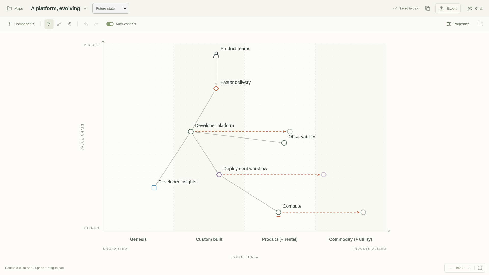
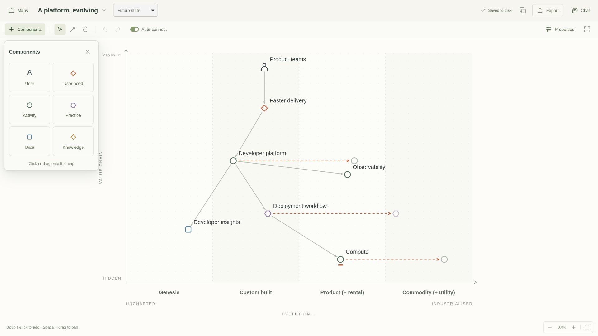
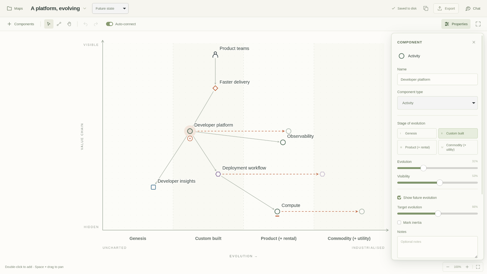

# Feature tour

[← Wardley Studio](../README.md) · [User guide](USER_GUIDE.md) · [API reference](../API.md)

A five-minute tour of the native app. Open **Maps** and choose **A platform, evolving** to follow along. The three screenshots use only the public example included in the repository.

## 1. Read the map

Start at **Product teams**, follow the need for **Faster delivery**, then trace the capabilities below it. Components near the top are more visible to the user. Moving left to right shows increasing evolution; it is not a timeline.



The bottom axis reads **Genesis → Custom built → Product (+ rental) → Commodity (+ utility)** for activities. Other component types have their own stage vocabulary. The map kind chooses the vocabulary displayed on the axis.

## 2. Add the right kind of component

Open **Components** (`A`). Click or drag a **User**, **User need**, **Activity**, **Practice**, **Data**, or **Knowledge** item onto the canvas. Double-clicking blank space creates a component of the current map's axis type.



For a quick experiment, add an activity called “Service catalogue.” Drag it horizontally to consider its evolution and vertically to place it in the value chain. Undo with `Ctrl/⌘ Z` when you want to return to the example.

## 3. Connect dependencies

Select a component and turn on **Auto-connect** before adding another: Studio creates the dependency for you. You can also drag the small `+` port to an existing component, or onto blank space to create a connected dependency.

To connect two existing components explicitly, choose the connection tool (`C`), click the source, then its dependency. Links follow components when you move them. Select a link to change its label or relationship.

## 4. Describe evolution and uncertainty

Select **Developer platform** and open **Properties** (`I`). Rename it, change its type or stage, adjust its position, and add notes. Turn on **Show future evolution** to mark a proposed destination with a dashed arrow. **Mark inertia** records resistance to change.



Try moving the target while leaving the current position fixed. That lets you discuss a possible future without erasing the current situation. Per-map undo and redo let you revisit edits during the session.

## 5. Make room to think

Close a drawer with `Escape`. Scroll to zoom, hold Space and drag to pan, and press `0` to fit the map. Press `F` for focus mode: the header and tools disappear, leaving the map. Press `F` again to return.

The drawers overlay the canvas without changing its view. Open only the tool you need for the current part of the discussion.

## 6. Keep, share, or host your maps

Edits autosave. Check the save indicator in the header; `Ctrl/⌘ S` saves immediately. Choose **Export** for editable JSON or a standalone SVG image.

A local workspace contains `metamodel.json` plus one JSON file per map. In **Maps → Workspace**, choose another local folder or connect to your own remote HTTPS server. Remote saves go to that server; **Reload** fetches other clients' updates. Connecting does not automatically migrate local maps. [Storage and deployment details →](HOSTED_API.md)

Open **Metamodel** from the Maps drawer to define your own types, shapes, colours, map kinds, and stage labels. Changes are validated against the existing maps.

## 7. Invite an assistant, if useful

When chat is enabled, open **Chat** and sign in using the supported Codex/ChatGPT connection. A useful first request is:

> Review this platform map. Explain which dependencies might be missing, without changing anything.

Turn off **Allow map edits** for discussion only. With editing enabled, ask for a specific change: the assistant can use the same map operations as you, inspect a rendered snapshot, and refine placement. Tool calls appear in the conversation; you can stop the reply and undo completed edits. **Web search** is a separate toggle.

Prompts, map context, and requested snapshots go to the AI service. The assistant cannot access workspace connection controls or tokens. Chat is optional at runtime and build time. [Assistant setup →](USER_GUIDE.md#chat-assistant)

## 8. Use the map from code

While the desktop app is running, read its current model with the included client:

```sh
python scripts/wardley-api.py GET /current-map/model
```

The response includes components, their types and stages, links, axes, and the metamodel. Discover routes with `GET /routes`, or read the OpenAPI description at `GET /openapi.json`. Scripts can create maps, move components, connect dependencies, and request snapshots.

For automation without an open desktop window, use the standalone API. Its routes operate on explicit map IDs and require a bearer token. [Editor API →](../API.md) · [Standalone API →](HOSTED_API.md)
